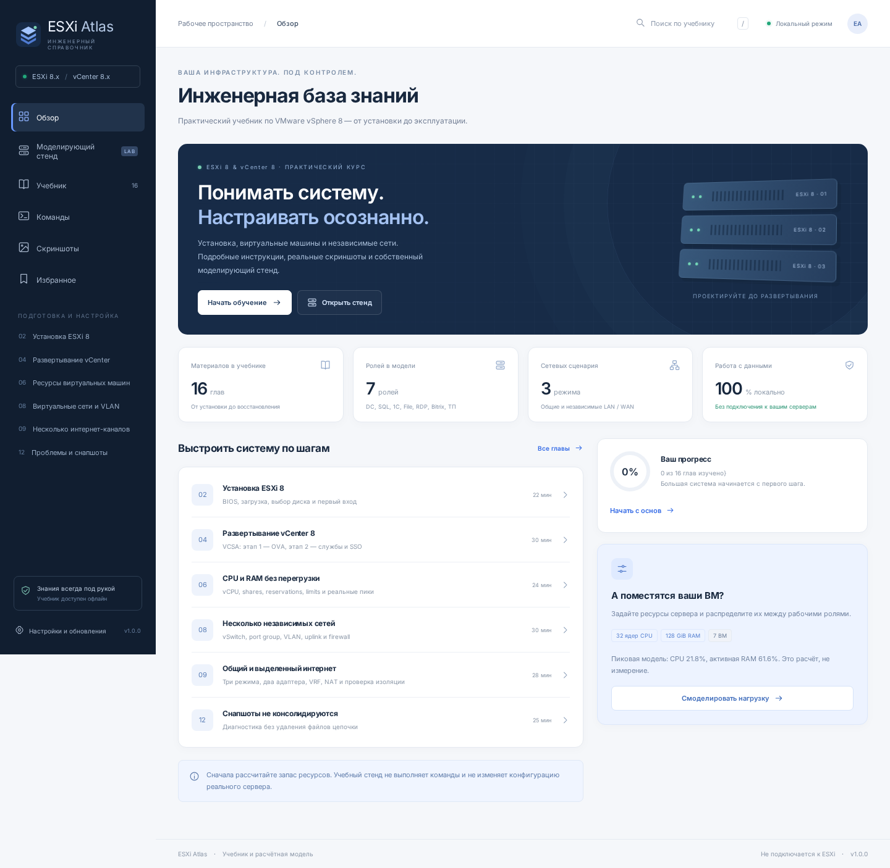

# ESXi Atlas

**Учебник по ESXi 8 / vCenter 8 и моделирующий стенд для Android и Windows.** Интерфейс на русском, материалы доступны офлайн в установленных приложениях.



## Что реализовано

- 16 подробных глав: установка ESXi, DCUI, datastore, VCSA в два этапа, инвентарь и обновления, CPU/RAM, диски, VLAN и независимые WAN, создание ВМ, запуск ролей, неконсолидирующиеся снапшоты, истёкшие пароли, сертификаты, диагностика и backup.
- Реальные атрибутированные скриншоты из публикаций. Версии указаны, спорные/старые интерфейсы помечены. Для недостающих шагов есть импорт собственных снимков — без подделки интерфейса VMware.
- Стенд с диапазонами: 1–2 CPU socket, 10–50 cores/socket, 2–6 GHz; 12–1024 GiB RAM; 1–5 SSD по 512–2048 GB; 1–5 HDD по 1000–32000 GB; 1–5 LAN.
- Роли DC, SQL, 1С, File, RDP, Bitrix, ТП. Каждая имеет редактируемые ресурсы и один из трёх режимов LAN/WAN. Учитываются отдельные VCSA Tiny и firewall.
- Рабочий день, пик, backup и ночь; воспроизводимый график CPU/RAM/дисков/сети; предупреждения и предложения стартовых размеров.
- Интерактивная карта: физические серверы, ВМ и виртуальные роутеры с размещением и ресурсами, внешние роутеры, провайдеры, коммутаторы, сетевые карты и линии с IPv4, VLAN и MAC. Доступны перемещение, удаление, локальное сохранение и перенос схемы в JSON-проекте.
- Условная анимация трафика в двух направлениях на включённых линиях; экспорт зацикленного GIF и многостраничного PDF со схемой и параметрами. Это визуализация, не эмуляция протоколов и не тест реальной связности. [Как пользоваться картой](docs/TOPOLOGY.md).
- Пошаговый план для каждой рабочей ВМ: поля мастера ESXi/vCenter, установка Windows Server 2022 или Ubuntu Server 22.04, VMware Tools, port group, VLAN, MAC, IP/маска/шлюз/DNS и проверки. Реальные скриншоты с источниками рядом с шагами; экспорт Markdown с текстом и ссылками и JSON-проект.
- Поиск, избранное, отметки изучения, копирование команд и отправка через системное меню / Telegram / WhatsApp по явному действию пользователя.
- Регулировка размера шрифта 100–200%: кнопка **Aa** в верхней панели и раздел «Настройки». Выбор сохраняется на устройстве.
- Проверка обновлений через GitHub Releases; установка после проверки подписи и подтверждения. Нативные оболочки Java/WebView и Electron.
- GitHub Actions: тесты, устанавливаемый подписанный APK и подписанный Windows-релиз постоянным лабораторным ключом из репозитория.

## Важно

**Стенд — расчётная модель, не эмулятор ядра ESXi и не benchmark.** Он не подключается к серверам и ничего на них не выполняет. Частота CPU, IOPS и коэффициенты ролей — допущения для предварительного планирования. NUMA, RAID, планировщик ESXi, реальные задержки и лицензии требуют отдельной проверки. [Методика и ограничения](docs/MODEL.md).

**Скриншоты — атрибутированная подборка, не собственная полная съёмка стенда.** В частности, один снимок консолидации относится к vSphere 7 и явно так подписан. [Реестр источников](docs/SCREENSHOTS.md).

**Подпись хранится в репозитории по явному решению владельца.** Это публичная лабораторная identity, а не граница безопасности: любой читающий репозиторий может подписывать пакеты от имени проекта. Для production нужен другой доверенный сертификат. [Подпись и выпуск](docs/SIGNING.md).

## Быстрый старт

```sh
npm ci
npm start
```

Предпросмотр: порт 3000. Для Windows `npm run desktop`, для Android `cd android && ./gradlew assembleDebug` после подготовки assets. Полные инструкции: [BUILD.md](docs/BUILD.md).

```sh
npm test
npx playwright install --with-deps chromium
npm run test:ui
```

## Структура

```text
app/                  общий офлайн-интерфейс
shared/model.cjs      модель и персональный план
shared/topology.cjs   проверка и представление интерактивной карты
shared/course.cjs     учебные главы
android/              нативный APK, копирование, пересылка, updater
desktop/             Electron shell, IPC, Windows updater
.github/workflows/    CI и подписанный выпуск
signing/public/       только публичные сертификаты и pins
docs/                 методика, источники, сборка и подпись
tests/                расчёты и браузерные сценарии
```

## Данные и безопасность

Проект, карта, прогресс и добавленные снимки остаются на устройстве. Нет аналитики, удалённого терминала, фонового сбора логов или рассылки. Команды изменения помечены; перед выполнением проверяйте имена объектов и снимайте backup. Не пересылайте пароли. Внешние ссылки открываются в системном браузере, не внутри привилегированного WebView.

Обновления не устанавливаются молча: сначала запрос, затем проверка, затем отдельное подтверждение установки/перезапуска. Windows self-signed сертификат подходит только для контролируемой лаборатории; для публичного распространения нужен доверенный издатель.

## Лицензии

Оригинальный код и учебный текст — MIT, см. [LICENSE](LICENSE). Сторонние изображения сохраняют права авторов и не перелицензируются под MIT. Inter распространяется по SIL OFL, текст в `app/assets/OFL.txt`. Кодировщик GIF gifenc — MIT, лицензия в `app/assets/GIFENC-LICENSE.txt`. Проект не связан с Broadcom/VMware и не распространяет их установочные образы или лицензии.
